<picture><source media="(prefers-color-scheme: dark)" srcset="assets/hero-dark.svg"></picture>

<a href="https://t.me/blxckfvde"><picture><source media="(prefers-color-scheme: dark)" srcset="assets/social-1-dark.svg"></picture></a>&nbsp;<a href="https://youtube.com/@blxckfvde"><picture><source media="(prefers-color-scheme: dark)" srcset="assets/social-2-dark.svg"></picture></a>&nbsp;<a href="https://vk.ru/blxckfvde"><picture><source media="(prefers-color-scheme: dark)" srcset="assets/social-3-dark.svg"></picture></a>&nbsp;<a href="https://open.spotify.com/artist/32FiSlUwclaOWDKaoE65jZ"><picture><source media="(prefers-color-scheme: dark)" srcset="assets/social-4-dark.svg"></picture></a>&nbsp;<a href="https://www.tiktok.com/@blxckfvde"><picture><source media="(prefers-color-scheme: dark)" srcset="assets/social-5-dark.svg"></picture></a>&nbsp;<a href="https://music.yandex.ru/artist/19975395"><picture><source media="(prefers-color-scheme: dark)" srcset="assets/social-6-dark.svg"></picture></a>

<picture><source media="(prefers-color-scheme: dark)" srcset="assets/about-dark.svg"></picture>

<picture><source media="(prefers-color-scheme: dark)" srcset="assets/stack-dark.svg"></picture>

<a href="https://github.com/thepoplive/PhonePod"><picture><source media="(prefers-color-scheme: dark)" srcset="assets/project-phonepod-dark.svg"></picture></a>&nbsp;<a href="https://github.com/thepoplive/RoundyDock"><picture><source media="(prefers-color-scheme: dark)" srcset="assets/project-roundydock-dark.svg"></picture></a>

<a href="https://github.com/thepoplive/BandDownloader"><picture><source media="(prefers-color-scheme: dark)" srcset="assets/project-banddownloader-dark.svg"></picture></a>&nbsp;<a href="https://github.com/thepoplive/AltGram-iOS"><picture><source media="(prefers-color-scheme: dark)" srcset="assets/project-altgram-ios-dark.svg"></picture></a>

<picture><source media="(prefers-color-scheme: dark)" srcset="assets/wave-dark.svg"></picture>

<a href="https://metawka.github.io/expressive-profile/?from=thepoplive"><picture><source media="(prefers-color-scheme: dark)" srcset="assets/credit-dark.svg"></picture></a>

